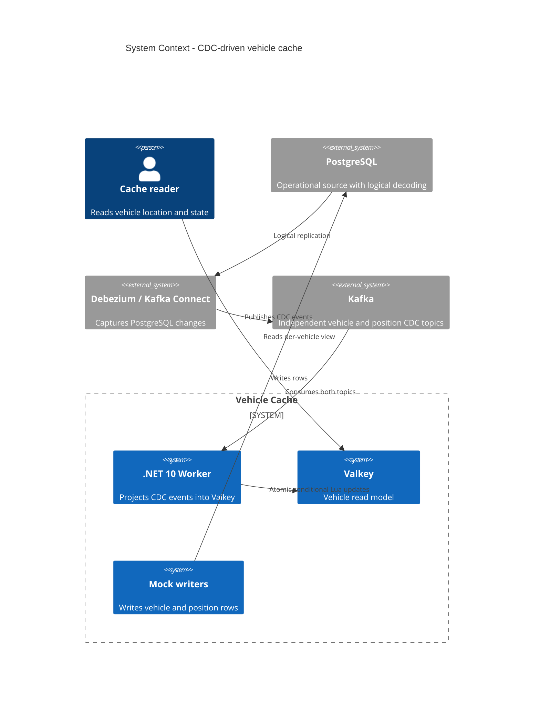
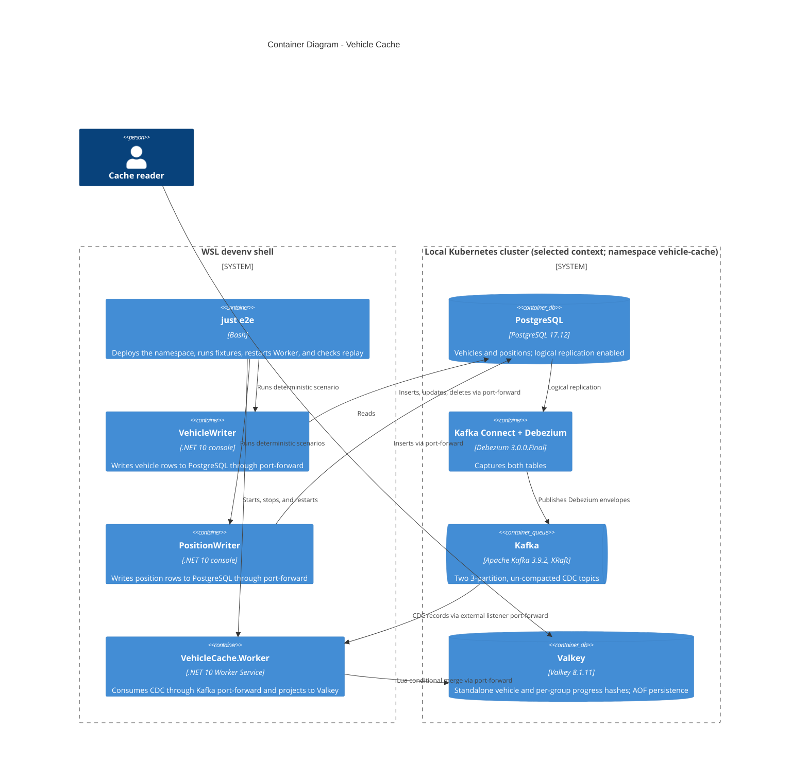
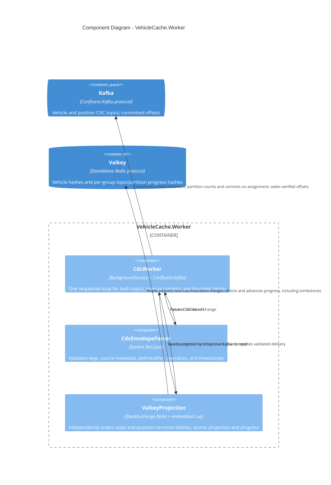

# C4 model

**Status:** Implemented architecture. The latest clean `just e2e` passed all
required scenarios, including infrastructure snapshot/stream readiness,
deterministic writers, Worker restart, duplicate delivery, and identical
cache-cleared full replay from offset 0.

## Context

## Container

## Worker components

Assignment and recovery guards are methods of `CdcWorker`. Progress is stored
in Valkey at `vehicle-cache:progress:<consumer-group>` with fields keyed by
topic/partition; it is not a separate Worker component. The Worker has no
PostgreSQL dependency. Readers are external consumers of Valkey; no read API
is implemented. Replay is offline and requires complete retained history;
partial vehicle-key loss is not automatically detected.
